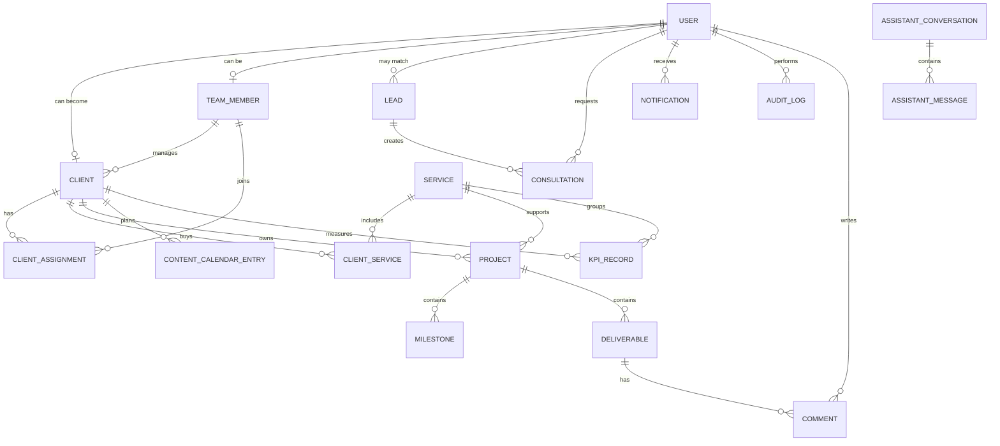
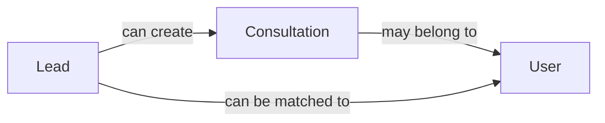
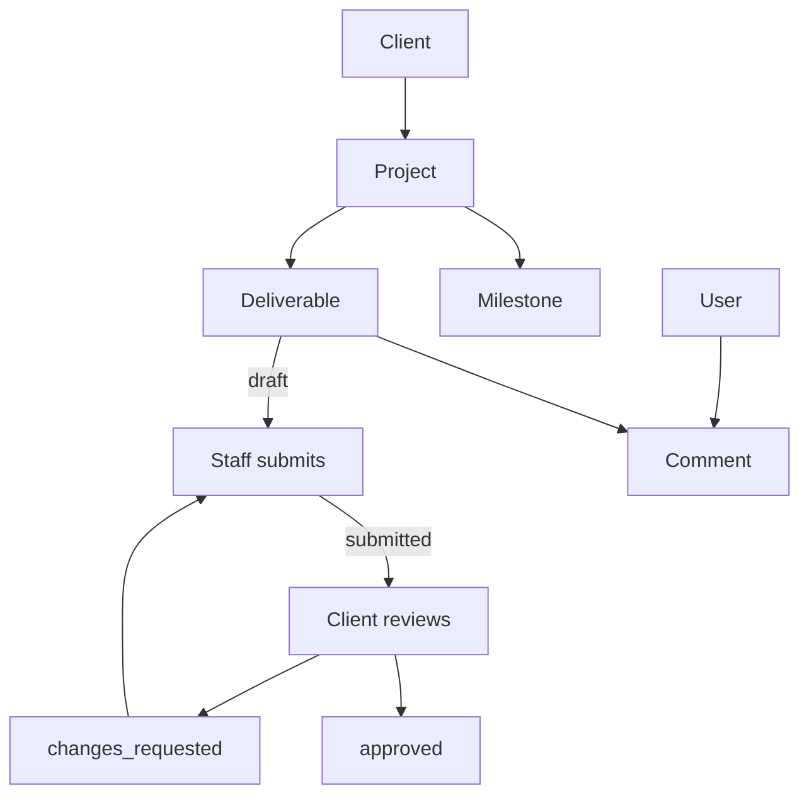

# Database schema in plain English

[Back to README](../README.md) · [Technical guide](technical-guide.md)

The schema is in [`prisma/schema.prisma`](../prisma/schema.prisma). PostgreSQL stores the records; Prisma gives the TypeScript code a safe way to read and write them.

## The big picture



**How to read it:** `||` means one. `o{` means many. For example, one `Client` can have many `Project` rows, but each project belongs to one client.

## 1. Accounts and access

### `User`

The one account table for visitors who sign up, clients, staff, and admins.

| Field | Meaning |
|---|---|
| `id` | Unique account ID |
| `email` | Unique sign-in address |
| `passwordHash` | Bcrypt hash; never the plain password |
| `role` | `REGISTERED_USER`, `TEAM_MEMBER`, or `ADMIN` |
| `status` | `NON_CLIENT` or `CLIENT` |
| `name`, `phone`, `businessName`, `businessType` | Profile details |
| `suspendedAt` | Date when access was suspended; empty means active |
| `createdAt`, `updatedAt` | Timestamps |

A client is still a `REGISTERED_USER`; activation changes `status` and creates a related `Client` row. Suspension is separate so suspending a client does not erase client status.

### `TeamMember`

Staff profile linked one-to-one to `User`. It stores an optional job title and supports two relationships: named account manager and assignment to many clients.

### `Client`

The business/customer profile connected one-to-one to a user. It stores company name, account manager, onboarding time, and notes. Projects, services, calendar entries, and KPIs point to this row.

### `ClientAssignment`

Join table between `Client` and `TeamMember`. It allows many staff members to work on one client and one staff member to work on many clients. The pair is unique, so the same assignment cannot be added twice.

## 2. Leads and consultations

### `Lead`

Every public booking or contact enquiry. `kind` is `booking` or `contact`; `status` moves through `new`, `qualified`, `consultation`, `proposal`, `negotiation`, `client`, or `lost`. Optional `userId` connects an enquiry to a later account. `notifiedAt` records successful email notification.

### `Consultation`

A requested or scheduled call. It can point to both a lead and a user. Status is stored as a flexible string such as `requested`, `scheduled`, `completed`, or `cancelled`.



## 3. Services and delivery

### `Service`

The agency catalogue, seeded from `lib/content.ts`. It has a unique slug, display name, and optional code.

### `ClientService`

Join table saying which services a client is using. The client/service pair is unique. `status` can be `active`, `paused`, or `ended`.

### `Project`

One body of work for one client and one service. It has a name, `active`/`paused`/`complete`/`archived` status, progress from 0 to 100, and optional dates.

### `Milestone`

A project checkpoint with title, due date, completion state, completion date, and display position.

### `Deliverable`

A reviewable piece of work. `fileUrl` is a safe HTTP(S) link, not an uploaded file. Types include `poster`, `reel`, `blog`, `report`, `source_file`, and `other`. Status is `draft`, `submitted`, `approved`, or `changes_requested`.

### `Comment`

A message on a deliverable. Both clients and staff can write. Deleting the deliverable deletes its comments.



## 4. Calendar and reports

### `ContentCalendarEntry`

A planned social/content post for a client. It stores platform, caption, optional creative URL, publish date, approval status, and client note. Approval values are `pending`, `approved`, and `changes_requested`.

### `KPIRecord`

One measurement for one client and period. It stores metric name, numeric value, unit, month label such as `2026-10`, source, and optional service. The source is currently `manual`; `meta` and `google` are reserved for future imports.

The code explicitly handles the nullable service case so two overall metrics do not accidentally become duplicates because PostgreSQL treats `NULL` values specially in unique indexes.

## 5. Content and operations

### `CMSContent`

Admin-editable public content: `page`, `blog`, `case_study`, `faq`, or `service`. A non-null `publishedAt` makes it public. `slug` is unique. Bodies are plain text, not raw HTML.

### `Notification`

An in-app message for one user. It stores text, optional destination URL, type, read timestamp, and creation timestamp.

### `Setting`

A small key/value configuration table. Current keys include company details, email wording, consultation SLA, and assistant knowledge/instructions. The admin settings pages validate the known keys.

### `AuditLog`

A record of important actions: actor, action name, entity, entity ID, optional JSON metadata, and timestamp. It provides accountability for account, access, and operational changes.

## 6. Assistant and rate limiting

### `AssistantConversation` and `AssistantMessage`

A conversation groups assistant messages. Each message has role (`user` or `assistant`), body, and timestamp. `userId` is optional because visitors can use the public assistant without signing in.

### `RateHit`

One counter per key and fixed hourly window. It protects public lead forms, login, signup, and the Groq assistant. PostgreSQL is used instead of an in-memory map so serverless instances share the limit.

## 7. Database rules

- IDs are Prisma `cuid()` strings.
- Most child records use `onDelete: Cascade` when they cannot exist without the parent.
- Optional references use `SetNull` so historical records can remain.
- Service references on projects use `Restrict` so a service with projects cannot be deleted accidentally.
- Indexes support role/status filters, client lists, project lists, dates, conversations, and rate-limit cleanup.
- Flexible business workflow labels are strings. Structural security vocabulary (`Role`, `UserStatus`) uses enums.
- Client-reachable queries scope by `clientId` in the database `where` clause.

## 8. Safe schema changes

```bash
# edit prisma/schema.prisma
npm run db:migrate -- --name explain_the_change
npm run db:generate
npm test
npm run typecheck
```

Commit both the updated schema and the generated migration directory. Deploy with:

```bash
npm run db:deploy
```

Do not edit an old migration after it has been applied to a shared database. Create a new migration. Back up production data before destructive changes.

## 9. A simple example

1. A person creates a `User`.
2. Their enquiry is a `Lead` and can be attached to that user later.
3. An admin activates the user: `User.status = CLIENT` plus one `Client` row.
4. The admin attaches `ClientService` rows and a `ClientAssignment`.
5. Staff create a `Project`, `Milestone`, and `Deliverable`.
6. The client decision updates the deliverable and may create a `Comment`.
7. Staff add `KPIRecord` rows for monthly reporting.
