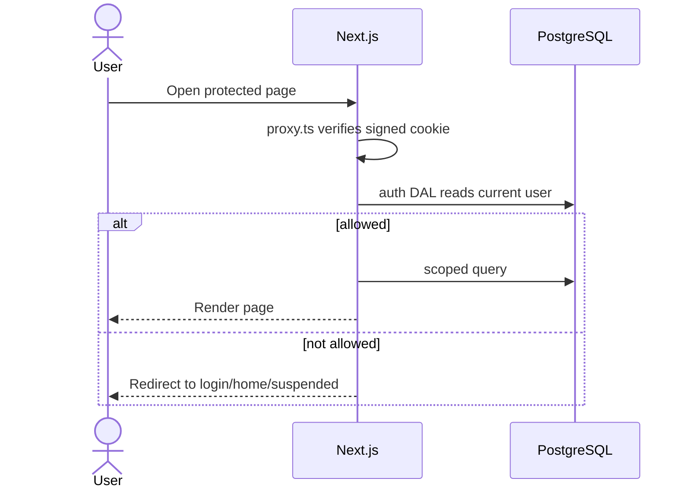
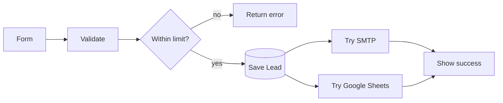

# Hashmetrik technical guide

[Back to README](../README.md) · [Database schema](database-schema.md) · [Backend setup](backend-setup.md)

This is the simple reference for developers and operators. It describes the code currently in this repository.

## 1. What this app is

Hashmetrik is one Next.js application for a digital-marketing agency. It contains:

- a public marketing website;
- lead and consultation capture;
- a client portal;
- a team delivery workspace;
- an administrator CRM and CMS;
- a small AI assistant.

All application data uses one PostgreSQL database. There is no separate Express API or Python backend.


## 2. Technology stack

| Layer | Technology | What it does |
|---|---|---|
| Runtime | Node.js (use 24 LTS) | Runs the app, tests, and seed script |
| Framework | Next.js `16.2.12` | Pages, server rendering, server actions, API route, metadata |
| UI | React `19.2.4` | Components and interactive forms |
| Language | TypeScript `5.9.3` | Type-safe JavaScript |
| CSS | Tailwind CSS `4.3.3` + custom CSS | Layout, responsive design, brand tokens |
| Motion | GSAP `3.15.0` + Motion `12.43.0` | Marketing animations and interactions |
| Icons | lucide-react `1.27.0` | UI icons |
| Database | PostgreSQL | Main data store |
| Database hosting | Neon (documented option) | Hosted PostgreSQL |
| ORM | Prisma `7.9.1` + `@prisma/adapter-pg` | Queries, migrations, generated client |
| Sessions | `jose` `6.2.7` | Signs/verifies the `hm_session` cookie |
| Passwords | `bcryptjs` `3.0.3` | Hashes passwords (10 rounds) |
| Email | Nodemailer `9.0.5` | SMTP lead notifications |
| AI | Groq HTTP API | Assistant answers |
| Spreadsheet | Google Sheets REST API | Optional enquiry copy |
| Tests | Node test runner | 91 logic tests in `tests/` |
| Quality | ESLint `9.39.5`, TypeScript | Lint and type checks |
| Hosting | Vercel or Node.js server | Production runtime |

The lockfile is the source of truth for exact transitive versions. `npm ci` installs it exactly.

## 3. Code layout

```text
app/                 Routes, pages, server actions, API route
  (site)/            Public site and CMS articles
  (app)/             Login, signup, dashboards, client, team
  (admin)/           Admin pages and admin login
  api/assistant/      POST /api/assistant
components/           Reusable UI and forms
lib/                  Auth, stores, validation, integrations, content, SEO
prisma/               schema.prisma, migrations, seed.ts
public/               Static assets
tests/                Pure logic tests
action files          Server-side mutations called by forms
proxy.ts              Session verification and redirects
```

`lib/*/store.ts` files are server-only database operations. `lib/*/schema.ts` and `lib/*/series.ts` contain pure validation/transform functions so Node can test them without a database.

## 4. Request and security flow



- `proxy.ts` checks whether the cookie is present, valid, and unexpired. It redirects requests but is not the final authorization check.
- `lib/auth/dal.ts` reads the live database row on every protected page and server action.
- `requireAdmin`, `requireStaff`, and `requireClient` are the main guards.
- The JWT is valid for seven days, `HttpOnly`, `SameSite=Lax`, and secure in production.
- Passwords never leave bcrypt hash form.
- Client reads/writes put `clientId` inside the database `where` clause.
- Staff lists are limited to managed/assigned clients. Staff write actions currently verify staff role but do not enforce assignment on every write.

## 5. Routes

| Route | Purpose |
|---|---|
| `/` | Marketing homepage |
| `/book`, `/contact` | Lead and consultation forms |
| `/insights`, `/insights/[slug]` | Published CMS content |
| `/login`, `/signup`, `/admin/login` | Authentication |
| `/dashboard` | Registered-user dashboard |
| `/dashboard/client` | Client projects and deliverables |
| `/dashboard/client/calendar` | Client calendar approvals |
| `/dashboard/client/reports` | Client KPI reports |
| `/dashboard/notifications` | In-app notifications |
| `/team` | Team queue |
| `/team/projects`, `/team/calendar`, `/team/reports` | Team delivery tools |
| `/admin` | Admin overview |
| `/admin/leads`, `/admin/consultations` | CRM pipeline |
| `/admin/users`, `/admin/clients`, `/admin/team` | Account and staffing management |
| `/admin/projects` | All-project admin view |
| `/admin/cms`, `/admin/assistant`, `/admin/settings` | Publishing, assistant, configuration |
| `POST /api/assistant` | Public AI assistant endpoint |
| `/robots.txt`, `/sitemap.xml` | Search discovery |

## 6. Main workflows

### Lead capture

1. `app/actions.ts` normalizes and validates the form.
2. PostgreSQL rate-limits the connection/IP.
3. The `Lead` row is saved first.
4. SMTP and Google Sheets are attempted in parallel.
5. Email success sets `Lead.notifiedAt`; a provider failure does not delete the lead.



### Client delivery

Staff create a project, add milestones, and save deliverables as HTTP(S) links. A deliverable moves through `draft → submitted → approved` or `changes_requested`. Clients can add comments. Notifications are in-app.

### Calendar, KPIs, and CMS

- Calendar entries hold platform, caption, creative URL, publish date, and approval status. Editing resets approval to `pending`.
- KPI records hold a metric, value, period (`YYYY-MM`), optional service, unit, and source (`manual`, `meta`, or `google`). Current entry is manual.
- CMS records are drafts until `publishedAt` is set. Published content appears on `/insights` and the sitemap.

## 7. Environment variables

Copy `.env.example` to `.env`.

| Variable | Required? | Use |
|---|---|---|
| `DATABASE_URL` | Yes | PostgreSQL connection |
| `SESSION_SECRET` | Yes for login | Session signing secret |
| `ADMIN_EMAIL`, `ADMIN_PASSWORD` | Seed only | First administrator |
| `GROQ_API_KEY` | Optional | Assistant; missing returns `503` |
| `GROQ_MODEL` | Optional | Defaults to `openai/gpt-oss-120b` |
| `SMTP_HOST`, `SMTP_PORT`, `SMTP_USER`, `SMTP_PASS` | Optional | Lead email |
| `LEAD_FROM_EMAIL`, `LEAD_NOTIFY_EMAIL` | Optional | Email addresses |
| `GOOGLE_SHEETS_ID`, `GOOGLE_SERVICE_ACCOUNT_EMAIL`, `GOOGLE_PRIVATE_KEY` | Optional | Sheets copy |
| `GOOGLE_SHEETS_TAB` | Optional | Defaults to `Leads` |
| `GOOGLE_SITE_VERIFICATION` | Optional | Search Console tag |

## 8. Deploy

```bash
npm ci
npm run db:generate
npm run db:deploy
npm run db:seed
npm run build
npm start
```

On Vercel, add environment variables first. The build generates Prisma but does not migrate or seed; run `db:deploy` and `db:seed` as an explicit release step. Static-only hosting cannot run this application because it needs server actions, authentication, and PostgreSQL.

## 9. Checks

```bash
npm test
npm run lint
npm run typecheck
npm run build
```

Tests prove pure logic. They do not prove live SMTP, Groq, Google permissions, database credentials, or browser behavior.

## 10. Current limitations

- No file uploads; deliverables are external links.
- KPI values are manually entered; no ad-platform sync.
- Calendar does not publish to social media.
- Only lead notifications use email; other notifications are in-app.
- No public password-reset or email-verification flow.
- No per-session database revocation list.
- No background retry queue for email or Sheets.
- No committed CI workflow or browser test suite.
- Some lists are capped at 200 and there is no pagination UI.
- `RESPECT_REDUCED_MOTION` is `false` in `lib/motion.ts`.
